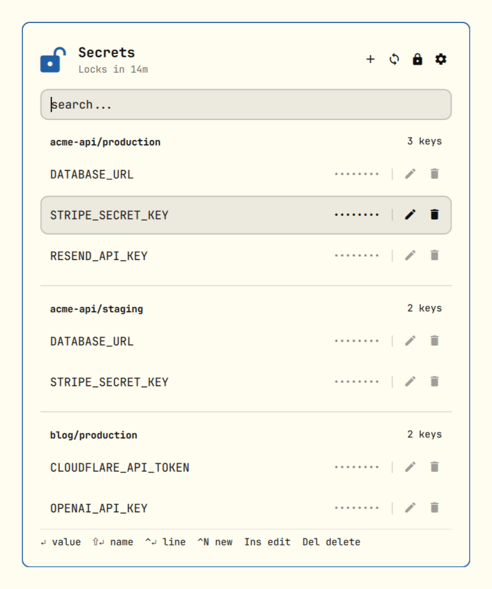
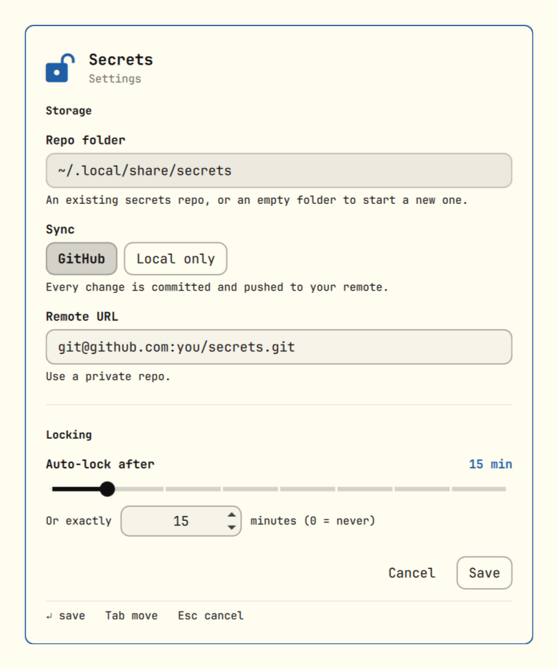

# Secrets

Omarchy plugin for keeping env secrets (API keys, tokens, database URLs) encrypted in your own private git repo, with a floating window to search, copy and edit them.



Every `project/env` pair is a dotenv file encrypted with [age](https://github.com/FiloSottile/age), so the repo only ever holds ciphertext. You unlock once with a passphrase, and every change is committed and pushed for you.

## Features

- Secrets grouped by `project/env`, e.g. `acme-api/production`
- Search across envs and key names as you type
- Copy a value, a key name, or the whole `KEY=value` line
- Add, edit, rename and delete, all from the keyboard if you like
- Paste `MY_VAR=1234` (or `export MY_VAR="1234"`) into the key field and it's split into name and value for you
- Deleting always asks for confirmation first
- Locks itself when your screen locks, or after a timeout you choose
- Every change is a git commit, pushed to GitHub in the background, or kept local-only if you prefer
- Refuses to encrypt if someone adds a key to your repo's recipients behind your back, and refuses to read any env file you didn't write yourself
- A `secrets` CLI that does everything the window does, plus `secrets run` to start a command with an env loaded

## Requirements

- `age` - not installed by default: `omarchy pkg add age`
- `keyctl` (keyutils), `jq`, `git`, `wl-clipboard` and `script` (util-linux), which a stock Omarchy install already has

## Install

```sh
omarchy plugin add https://github.com/cossssmin/omarchy-secrets.git --enable
```

The lock icon appears in the bar's right section. Click it to open the window.

The window is a regular window rather than a bar popup, so clicking elsewhere doesn't close it. Hyprland would tile it though, so float it with a rule in `~/.config/hypr/hyprland.lua`:

```lua
o.window({ class = "^org.quickshell$", title = "^Secrets$" }, { float = true, center = true, size = { 460, 560 } })
```

To open it with a key, bind the toggle in `~/.config/hypr/bindings.lua`. For example, `SUPER + SHIFT + S`, which is Google Maps on a stock install:

```lua
hl.unbind("SUPER + SHIFT + S")
o.bind("SUPER + SHIFT + S", "Secrets", "omarchy-shell -q shell toggle cossssmin.secrets")
```

For the CLI, link it somewhere on your `PATH`:

```sh
ln -s ~/.config/omarchy/plugins/cossssmin.secrets/bin/secrets ~/.local/bin/secrets
```

## Setup

Open the window and pick a passphrase. That creates:

- your age identity, passphrase-protected, at `~/.config/secrets/identity.age`
- the secrets repo at `~/.local/share/secrets`, with your public key in `.age-recipients`

There's no way to recover the passphrase, so keep it somewhere safe.

To back it up on GitHub, create a **private** repo, then open the settings (gear icon, or `Ctrl + ,`) and paste its URL into the remote field. Click the sync button once to push what's there; from then on, every change is pushed for you.

Rather keep everything on this machine? Pick **Local only** in the settings instead.

Tip: also create an offline backup key. Everything gets re-encrypted to it as well, so a lost passphrase or laptop doesn't mean lost secrets:

```sh
secrets backup-key ~/backup.txt
```

Print it or put it on a USB stick, then delete it from your machine.

### Another machine

Copy `~/.config/secrets/identity.age` over (it's encrypted with your passphrase), clone your secrets repo, and set its folder in the settings. Then unlock, and run `secrets trust` once: on a new machine, any key in `.age-recipients` other than this identity's (your backup key, for one) needs your approval before anything gets encrypted.

## Usage

| Action | Copies |
|--------|--------|
| Click the key name | the name |
| Click the `••••••••` dots, or anywhere else on the row | the value |
| `Enter` | the value |
| `Shift + Enter` | the name |
| `Ctrl + Enter` | the `KEY=value` line |

The pencil on a row edits that key. Click a group's name to rename it. The trash icon deletes the key, after you confirm.

### Keyboard

| Key | Action |
|-----|--------|
| `↑` / `↓` | Move the selection |
| `Ctrl + N` | Add a secret |
| `Ctrl + E` or `Insert` | Edit the selected key |
| `Ctrl + D` or `Delete` | Delete the selected key (after you confirm) |
| `F2` | Rename the selected key's group |
| `Ctrl + ,` | Open the settings |
| `Tab` / `Shift + Tab` | Move between fields in the editor |
| `Esc` | Leave the editor, rename or dialog, then close the window |

`Delete` only deletes a key when there's nothing for it to delete in the search field, so typing a search never removes anything by accident. The confirm dialog opens with **Cancel** selected, so a reflexive `Enter` doesn't delete either.

### CLI

```sh
secrets status                                 # locked or unlocked
secrets unlock                                 # asks for your passphrase
secrets ls                                     # list envs
secrets keys acme-api/production               # list key names
secrets get acme-api/production STRIPE_KEY     # print a value
secrets set acme-api/production STRIPE_KEY     # prompts for the value
secrets rm acme-api/production STRIPE_KEY      # remove a key (or the whole env, without a KEY)
secrets mv acme-api/staging acme-api/preview   # rename an env (needs to be unlocked)
secrets export acme-api/production > .env     # dump an env as dotenv
secrets run acme-api/production -- npm start   # run a command with the env loaded
secrets lock
secrets config                                 # print the settings
secrets config set sync local                  # change one (see the next section)
secrets trust                                  # approve changed recipients, after reviewing them
```

Run `secrets help` for the full list, including `backup-key`, `rotate` and `rekey`.

## Configure

Open the settings from the gear icon, or with `Ctrl + ,`:



- **Repo folder** - where the encrypted files live, `~/.local/share/secrets` by default. Point it at an existing secrets repo, or at an empty folder to start a new one there.
- **Sync** - **GitHub** pushes every change to the remote you set, **Local only** commits but never pushes.
- **Auto-lock after** - how long an unlock lasts, 15 minutes by default. Pick a preset on the slider, from 5 minutes up to never, or type any number of minutes (`0` never locks).
- **Lock when the screen locks** - on by default. Suspending locks the screen first, so it covers that too.

They're saved to `~/.config/secrets/config`, which the CLI reads as well, so you can also edit them from a terminal:

```sh
secrets config set dir ~/Work/secrets
secrets config set sync github           # or local
secrets config set remote git@github.com:you/secrets.git
secrets config set ttl 3600              # seconds, 900 by default, 0 = never
secrets config set lock-on-screen-lock false
```

Environment variables with the same names as the config keys (`SECRETS_DIR`, `SECRETS_SYNC`, `SECRETS_TTL`, `SECRETS_LOCK_ON_SCREEN_LOCK`, `SECRETS_IDENTITY`) override the file.

## How it works

- Each env is a dotenv file, encrypted with age to every public key in `.age-recipients`. Adding or rotating a key re-encrypts everything.
- `unlock` decrypts your identity into the kernel keyring (`keyctl`), never to disk. Locking drops it, and a reboot clears it.
- The window hands passphrases and values to the CLI over stdin, never as command-line arguments where other processes could see them. In a terminal, `secrets set` and `secrets unlock` prompt for them for the same reason.
- Commits are signed if your git config signs commits, and pushed in the background. If a push fails (say, you're offline), the header shows how many commits are waiting and the sync button retries.
- Your secrets are encrypted to every key in `.age-recipients`, so anyone who could slip their own key in there (with a stolen GitHub token, say) would be able to read everything you save afterwards. To prevent that, the approved list is kept locally in `.git`, which is never pushed, and nothing gets encrypted while the file doesn't match it. The window shows a warning, and `secrets trust` approves the change once you've checked it's yours.
- age doesn't verify who encrypted a file, and your public key is right there in the repo, so the same attacker could also plant an env file of their own, with values they chose. That's why every env starts with a `#mac=` line: an HMAC over its path and contents, keyed with a secret that lives inside your encrypted identity (and your backup key). Anything without a valid one is refused, so a planted file can't feed you its values or sneak something like `BASH_ENV` into `secrets run`.
- Only `*.env.age` files and `.age-recipients` are ever committed, so a stray plaintext `.env` you drop in the folder by accident stays on your machine.

Note that while it's unlocked, **any process running as you can decrypt your secrets**, including scripts and AI agents. Locking on screen lock and a sensible auto-lock keep that window short; lock it by hand before running something you don't trust.

A few more things to know:

- Copied values end up in Omarchy's clipboard history like anything else you copy.
- Values are single-line, so multi-line values like PEM keys aren't supported yet.
- Commit messages include env names, like `update acme-api/production`, but never keys or values.
- While unlocking, your decrypted identity sits for a moment in a private file under `$XDG_RUNTIME_DIR` (memory-backed, readable only by you), and is deleted right after. A hard kill at exactly that moment would leave it there until you log out.
- Someone who can push could still roll an env back to an older version of itself, which would carry a valid MAC. Old values only, but worth knowing.

## Remove

```sh
omarchy plugin remove cossssmin.secrets
```

Then delete the float rule and keybinding from your Hyprland config, and the CLI link if you made one. Your repo, identity and settings stay where they are; delete `~/.local/share/secrets` (or your repo folder) and `~/.config/secrets` too if you're done with them.

## License

MIT
